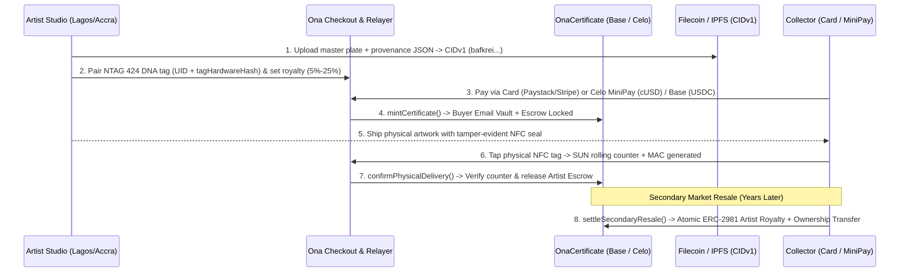

# Ona Protocol Specification (v0.2)

**Milestone 1 Deliverable — UX Architecture, User Flows & Open NFC/ERC-721 Contract Standard**  
**Author:** Jethro Adebisi ([Portfolio](https://jethrotheuxpert.vercel.app/) · [BlockPrint](https://blockprint.team))  
**License:** MIT

---

## 1. System Thesis

Fine artists in emerging markets (Lagos, Accra, Nairobi) lose 100% of secondary market upside when physical works resell privately, while paper certificates of authenticity are routinely lost or forged. Existing NFT platforms failed traditional art collectors by forcing seed phrases, browser extensions, and volatile gas fees onto non-crypto buyers.

**Ona** decouples the collector purchase experience from cryptographic verification:
1. **Collectors pay in local fiat or mobile stablecoins** (Paystack NGN, Stripe USD, Celo MiniPay `cUSD`, or Base `USDC`) with zero seed phrases; an email-abstracted custodial vault holds the certificate until the collector optionally exports to self-custody.
2. **Physical artworks carry tamper-evident NXP NTAG 424 DNA tags** whose hardware-protected monotonic counter and cryptographic `SUN` (Secure Unique NFC) MAC prove physical possession on every tap—defeating static QR/URL copying.
3. **Primary sale funds are escrowed until delivery tap**: when the collector taps the physical tag upon receiving the piece, `confirmPhysicalDelivery()` verifies the monotonic counter on-chain, marks the piece physically verified, and releases primary sale funds to the artist.
4. **Secondary resales enforce artist royalties atomically**: `settleSecondaryResale()` reads `royaltyInfo()` (`ERC-2981`) and splits payment directly between the original artist, the selling collector, and the protocol in one transaction.

---

## 2. End-to-End User Flows

---

## 3. Cryptographic NFC Tag Pairing (`NTAG 424 DNA SUN`)

Static QR codes and basic NDEF NFC tags (`NTAG213`) emit an unchanging URL, allowing anyone who photographs a tag in a gallery to impersonate physical possession. Ona specifies **NXP NTAG 424 DNA** (ISO/IEC 14443A) operating in **Secure Unique NFC (SUN)** mode:

* **Provisioning at Studio:** Each tamper-loop tag holds a unique 7-byte UID (`tagUid`) and a hardware-locked 128-bit secret key. Ona records `tagHardwareHash = keccak256(tagUid || secretVerifier)` on-chain during `mintCertificate()`.
* **Per-Tap Rolling Challenge:** Every physical phone tap increments a 24-bit hardware counter (`ctr`) inside the NFC silicon and appends a truncated MAC over `(tagUid || ctr)`:
  `https://adebisijethro.github.io/ona-art-provenance/?uid=04A28F19C36B80&ctr=00000F&mac=8E41C09B227AD104`
* **On-Chain Replay Rejection:** `OnaCertificate.sol` stores `uint32 lastTapCounter` per `tokenId`. Any submission with `tapCounter <= art.lastTapCounter` reverts with `InvalidNFCCounter()`, guaranteeing that copied or bookmarked URLs cannot trigger delivery release or forge an inspection checkpoint.

---

## 4. Smart Contract Interface (`contracts/OnaCertificate.sol`)

| Function | Standard / Role | Behavior |
| :--- | :--- | :--- |
| `supportsInterface(bytes4)` | `ERC-165` | Advertises `ERC-721` (`0x80ac58cd`), `ERC-721Metadata` (`0x5b5e139f`), and `ERC-2981` (`0x2a55205a`). |
| `royaltyInfo(uint256, uint256)` | `ERC-2981` | Returns `(artist, salePrice * royaltyBps / 10000)` up to `2500 bps` (25%). |
| `mintCertificate(...)` | Relayer / Admin | Mints certificate to collector custodial vault or wallet, binds `tagHardwareHash`, pins `ipfs://bafkrei...`, and locks primary escrow. |
| `confirmPhysicalDelivery(tokenId, preimage, tapCounter)` | Collector / Relayer | Validates `tapCounter > lastTapCounter` and hardware hash, sets `physicalVerified = true`, releases escrowed proceeds to artist, and appends `"NFC_DELIVERY_CONFIRMED"` checkpoint. |
| `listForResale(tokenId, token, askPrice)` | Collector | Opens an on-chain secondary market ask in native currency, Base `USDC`, or Celo `cUSD`. |
| `settleSecondaryResale(tokenId, newBuyer, tapCounter)` | Buyer | Atomically transfers `artistRoyalty` to original artist, `protocolFee` (5%) to treasury, and `sellerNet` to seller before transferring the ERC-721 token. |
| `exportToSelfCustody(tokenId, externalWallet)` | Relayer | Moves certificate from email custodial vault to collector's self-custody wallet while preserving full `_provenanceHistory`. |

---

## 5. Multi-Ecosystem Standard Mapping

While the primary reference deployment targets **Base (`8453` / `84532`)** and **Celo MiniPay (`42220` / `44787`)** with **Filecoin/IPFS CIDv1** archival, Ona's metadata envelope and verification SDK map cleanly across partner ecosystems:

| Ecosystem | Certificate Standard | Royalty Standard | Settlement Rail |
| :--- | :--- | :--- | :--- |
| **Base L2** | `ERC-721` | `ERC-2981` + `settleSecondaryResale` | Card (Stripe/Paystack) + `USDC` |
| **Celo / MiniPay** | `ERC-721` | `ERC-2981` + `settleSecondaryResale` | Opera MiniPay `cUSD` + Mobile Tap |
| **Filecoin / IPFS** | `CIDv1` (`raw` / `sha2-256`) | Embedded in Provenance Envelope | Permanent content-addressed archival |
| **Tezos** | `FA2` (`TZIP-12`) | `TZIP-21` Royalties Metadata | `tez` / `USDt` |
| **Cardano** | Native Asset (`CIP-68`) | `CIP-27` Royalty Token | `ADA` / `USDM` |
| **Flow** | Cadence `NonFungibleToken` | `MetadataViews.Royalties` | Dapper / Fiat Card |
